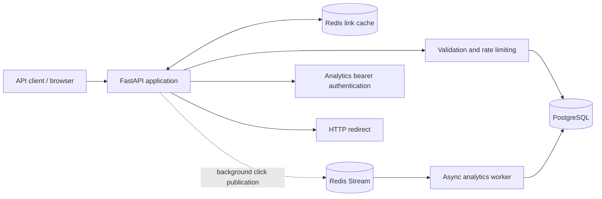
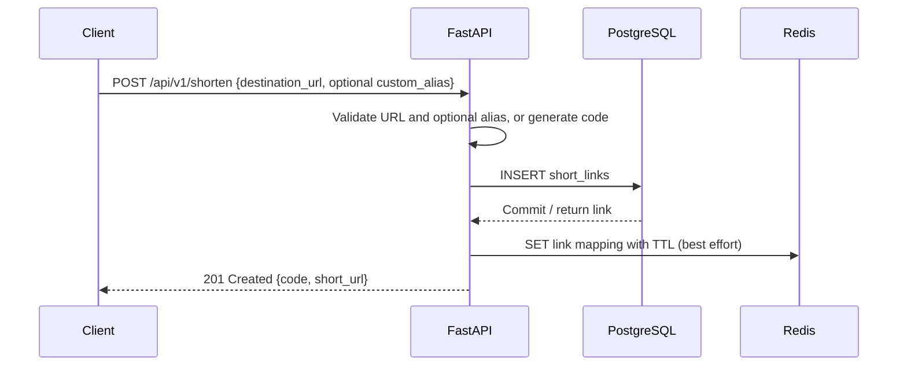
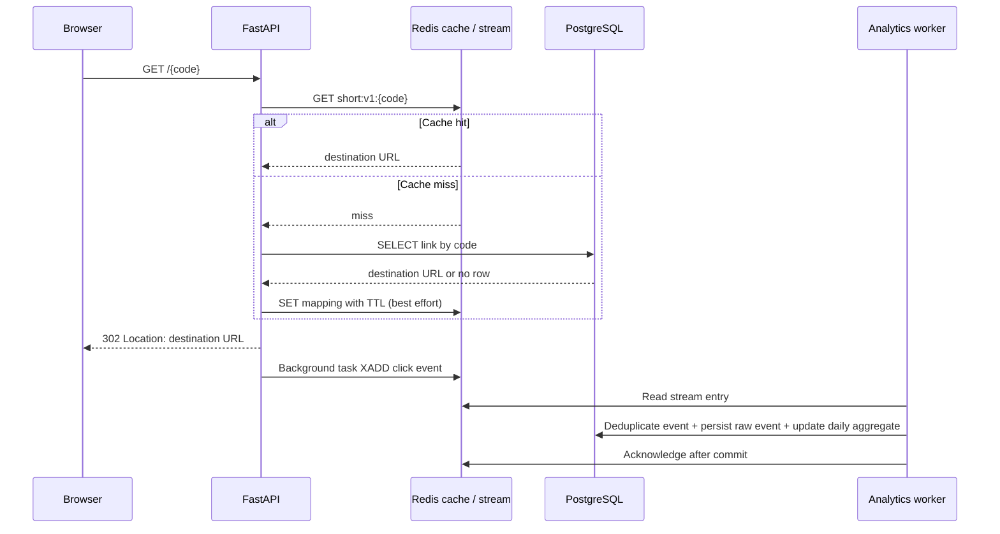

# URL Shortener - Engineering Design

**Status:** Baseline design implemented as an assignment prototype; capacity targets remain unverified
**Scope:** Mandatory URL-shortener use case  
**Stack constraints for this design:** Python 3.11+, FastAPI, SQLAlchemy 2.0 async, PostgreSQL, and Redis

## 1. Goals and Assumptions

This design covers link creation, persistent storage, redirects, and click analytics. PostgreSQL is the source of truth. Redis is a disposable lookup cache and, for the proposed analytics flow, a Redis Stream transport. The performance targets in Section 9 are design inputs, not results already demonstrated by a benchmark.

The requirement analysis currently says that no stack is mandated. This design treats the stack listed in the design request as a constraint for this architecture only. If the stack is intended to be a confirmed project requirement, update the requirement analysis and approval record separately.

The service does not fetch destination URLs; it validates and stores them, then redirects visitors. Only absolute `http` and `https` destinations are accepted. The minimum behavior generates short codes; custom aliases are implemented as an optional, separately accepted brownfield extension documented below. The accepted ambiguous-scenario extension adds analytics authentication, per-client rate limiting, and bounded analytics retention. Link updates/deletion, expiration, ownership, destination abuse review, and loss-resistant event delivery remain outside scope.

## 2. High-Level Architecture

### Components

- **FastAPI application:** Provides link creation, redirect, and analytics endpoints. Request handlers use asynchronous SQLAlchemy sessions and Redis clients.
- **PostgreSQL:** Stores short-link mappings, raw click events, daily aggregates, and event-ID deduplication markers. It remains authoritative when the cache is empty or unavailable.
- **Redis cache:** Holds frequently resolved short-code mappings with a finite TTL. Cache loss affects performance, not correctness.
- **Redis Stream and analytics worker:** Buffers events containing only event ID, short-link code, and UTC click timestamp. The worker resolves the code to its internal link ID for aggregation, stores the raw event within its retention window, updates the daily aggregate, records an idempotency marker, and acknowledges after the transaction commits.
- **Analytics access and rate limits:** Analytics requires the configured shared Bearer key. Redis-backed fixed-window limits apply per client address; forwarded addresses are used only behind explicitly configured trusted proxies.

## 3. Data Flows

### 3.1 Creation

1. Client calls `POST /api/v1/shorten` with a destination URL and, optionally, a custom alias.
2. FastAPI validates that the URL is absolute and uses the `http` or `https` scheme.
3. If an alias is supplied, the service validates the approved alias rules; otherwise it generates a random Base62 short code. It inserts the mapping into PostgreSQL. The unique constraint protects the shared alias/generated-code namespace; generated-code collisions retry a bounded number of times, while an alias collision returns `409 Conflict`.
4. After the database commit, the service writes the mapping to Redis with the configured TTL. Cache write failure is logged and metered but does not fail an already-committed creation.
5. The API returns `201 Created` with the short code and short URL.

### 3.2 Redirection and Analytics

1. Browser calls `GET /{code}`.
2. FastAPI looks up `short:v1:{code}` in Redis.
3. On a cache miss, it reads PostgreSQL and populates Redis. An unknown code returns `404 Not Found`.
4. For a known code, the service schedules a FastAPI background task to publish a click event to the Redis Stream, then returns a `302 Found` redirect to the stored URL. A temporary redirect avoids browsers permanently caching the mapping and bypassing future analytics.
5. An analytics worker reads the stream. In one PostgreSQL transaction it records the event ID for deduplication, inserts the raw event if it is inside the 90-day window, and increments the event date's daily aggregate if it is inside the 12-month window. It acknowledges the stream entry only after commit.
6. `GET /api/v1/links/{code}/analytics` requires a valid shared Bearer key and sums the retained daily aggregates over the trailing 12 calendar months.

The task is scheduled as part of the response handling; a process crash before the background task publishes the event can lose that click. This is an explicit best-effort trade-off for the prototype. If analytics must be loss-resistant, publish the event to the stream synchronously before returning the redirect, or use a transactional outbox and a dispatcher. In either case, keep PostgreSQL work out of the redirect's critical path where possible.

## 4. Implemented API Surface

| Method and path | Behavior | Success / errors |
|---|---|---|
| `POST /api/v1/shorten` | Validate and create a short link. Request body: `{"destination_url":"https://example.com/path","custom_alias":"summer-sale"}`; `custom_alias` is optional. Rate limited per client address (10/minute). | `201` with `code`, `short_url`, and `created_at`; `422` for invalid input; `409` (`short_code_conflict`) if a custom alias is already used; `429` when limited; `503` if persistence/rate limiting is unavailable. `short_url` uses the configured `URL_SHORTENER_PUBLIC_BASE_URL` origin. |
| `GET /{code}` | Resolve a short code and redirect. Rate limited per client address (120/minute). | `302` with `Location`; `404` only after PostgreSQL confirms no mapping; `429` when limited; `503` when the database lookup or rate limiting fails. |
| `GET /api/v1/links/{code}/analytics` | Retrieve click analytics over the trailing 12 calendar months. Requires the configured shared Bearer key and is rate limited per client address (60/minute). | `200` with `code` and `clicks_total`; `401` for missing/invalid key; `404` for an unknown code; `429` when limited; `503` when PostgreSQL, Redis rate limiting, or analytics authentication configuration is unavailable. Aggregates are asynchronous and may lag recent redirects. |

Errors use the JSON shape `{"error":{"code":"...","message":"...","details":...}}`. Rate limits use a 60-second fixed window. Configure `URL_SHORTENER_ANALYTICS_API_KEY` with a private random value of at least 32 characters. Analytics uses one shared key and does not provide per-user or per-link authorization. Rate-limit keys contain an HMAC of the resolved client address and expire with the window. Forwarded addresses are honored only when the immediate peer is in `URL_SHORTENER_TRUSTED_PROXY_CIDRS`; otherwise proxy headers are ignored. Keep the service off public deployment until remaining abuse, ownership, and administrative controls are addressed.

### 4.1 Accepted custom-alias extension

The brownfield scenario adds an optional `custom_alias` field to link creation.
Aliases are 3–16 lowercase ASCII letters, digits, or hyphens, with an
alphanumeric first and last character. Uppercase input is rejected. The names
`api`, `health`, `metrics`, `docs`, `redoc`, and `openapi.json` are reserved.
Aliases are case-sensitive under the URL contract, but only lowercase values
are accepted. A duplicate alias returns HTTP `409` with error code
`short_code_conflict`; database uniqueness is authoritative under concurrent
requests.

Custom aliases share `short_links.code` with generated codes. The existing
`VARCHAR(16)` column and unique constraint cover the accepted contract; no
migration is needed. Callers that omit `custom_alias` retain the original
generated Base62 behavior and response shape.

## 5. PostgreSQL Schema

### `short_links`

| Column | Type | Constraints / purpose |
|---|---|---|
| `id` | `BIGINT GENERATED ALWAYS AS IDENTITY` | Primary key used by internal foreign keys. |
| `code` | `VARCHAR(16)` | Not null, unique; public short code. Generate 8 random Base62 characters initially; retry on uniqueness conflict. |
| `destination_url` | `TEXT` | Not null; validated absolute HTTP(S) URL. |
| `created_at` | `TIMESTAMPTZ` | Not null, default `now()`. |

### `click_events`

| Column | Type | Constraints / purpose |
|---|---|---|
| `event_id` | `UUID` | Primary key; generated when the click event is created and used for idempotency. |
| `code` | `VARCHAR(16)` | Not null; foreign key to the unique public short-link code. |
| `clicked_at` | `TIMESTAMPTZ` | Not null; event time in UTC. |

The raw event stores only its ID, short-link code, and UTC timestamp. It does
not store IP addresses, user-agent values, or other personal data.

### `daily_click_aggregates` and `processed_click_event_ids`

`daily_click_aggregates` has `(link_id, bucket_date)` as its primary key and
stores the count for that link and UTC day. Rows older than 12 calendar months
are removed. `processed_click_event_ids` stores only event ID and processing
timestamp, preventing redeliveries from incrementing a rollup after the raw
event expires; markers older than the aggregate retention horizon are removed.

### Indexes and query rationale

- Unique B-tree index on `short_links(code)` supports both collision prevention and direct code lookup. PostgreSQL creates this index for the unique constraint.
- Primary key on `short_links(id)` supports aggregate foreign keys and worker updates.
- Primary key on `click_events(event_id)` makes event processing idempotent.
- Composite B-tree index on `click_events(code, clicked_at DESC)` supports per-link raw-event queries.
- Index on `processed_click_event_ids(processed_at)` supports retention cleanup.
- Avoid extra indexes until a query or measured workload requires them; each index adds write and storage cost.

The analytics response sums daily aggregates inside the configured 12-calendar-
month horizon. Migration `20261012_01` seeds each existing lifetime total into
a baseline bucket dated on migration day; that legacy total remains visible
for up to 12 months after migration while new clicks accrue in their actual
daily buckets. This is a transition baseline, not reconstructed historical
daily data. Migration `20261012_02` converts existing raw-event references to
short codes.

## 6. Redis Cache and Telemetry

### Link cache

- **Key:** `short:v1:{code}`
- **Value:** Compact serialized mapping containing `link_id` and `destination_url`.
- **TTL:** Start with a configurable one-hour TTL (`LINK_CACHE_TTL_SECONDS=3600`); tune using observed hit rate, database load, and any future update/expiration semantics.
- **Policy:** Cache-aside on redirect; populate after a database miss. Populate after successful creation as a best effort. PostgreSQL remains authoritative.
- **Outage behavior:** A Redis cache read/write failure falls back to PostgreSQL. Emit a metric and structured log; do not return a false 404 because the cache is unavailable.
- **Invalidation:** Links are immutable in this baseline, so TTL bounds staleness. If link edits, deactivation, or deletion are added, invalidate the cache after the database commit.

### Click event stream and worker

- FastAPI `BackgroundTasks` publishes only (`event_id`, `code`, `clicked_at`) to a Redis Stream after the redirect response is sent. The raw click table stores those same three fields and no IP address or user-agent.
- A separate async worker consumes through a Redis consumer group. It commits the idempotency marker, eligible raw event, and daily aggregate update in one PostgreSQL transaction, then acknowledges the stream item.
- Retry consumer-group initialization and stream operations after Redis connection failures so the independently run worker can recover without an external restart.
- The worker uses `XAUTOCLAIM` and `XTRIM MINID`, requiring Redis 6.2 or newer.
- If a worker fails before commit, the item remains pending for retry. The event-ID deduplication ledger prevents duplicate increments on retry. Raw rows are removed after 90 days; daily aggregate buckets and deduplication markers are retained for 12 calendar months.
- Check trimming periodically, not after every worker batch. Trim only an acknowledged prefix, bounded by the oldest pending entry and the configured recent-entry window. Cache the boundary only when it actually limits the trim; if the recent-entry retention boundary limits it, recheck that boundary on the next scheduled trim. Never trim unprocessed or pending events; a stalled entry may therefore cause the stream to exceed its target maximum length. This prototype policy is count-based, and production retention should be reviewed against analytics and Redis durability requirements.
- Redis persistence and replication should be configured to match the required durability; Redis is not a substitute for the PostgreSQL record.
- Monitor background publish failures, pending event count, processing lag, database transaction failures, and rejected/invalid destination URLs. Rate-limit identifiers are HMACed and short-lived; do not log IP addresses or use them in metric labels.

## 7. Runtime and Failure Handling

- Use one async SQLAlchemy engine per application process, an async connection pool, and a request-scoped `AsyncSession`; always close sessions after use.
- Reuse an async Redis client/connection pool per process. Keep pools and worker counts configurable so total connections remain within PostgreSQL and Redis limits.
- Apply bounded timeouts to database and Redis operations. Return a service error when PostgreSQL cannot create or resolve a link; for cache failures, fall back to PostgreSQL.
- The cache may be flushed or unavailable without data loss. Redis Stream loss or failure to publish a background click can lose analytics under the best-effort baseline; expose this limitation and alert on it.
- Run the analytics worker independently from API workers so stream processing can scale separately.

## 8. Security, Scaling, and Observability

- Accept only absolute HTTP and HTTPS destinations; reject malformed URLs and other schemes. The service does not dereference the destination during creation, reducing server-side request forgery exposure.
- Use parameterized SQL through SQLAlchemy, keep credentials in environment/secret management, and avoid logging full URLs if they may contain sensitive query values.
- Analytics requires a configured shared Bearer key. Fixed-window rate limits are enforced through Redis at 10 creations, 120 redirects, and 60 analytics requests per client per minute; they fail closed if Redis is unavailable. They do not replace destination abuse review, link ownership, or administrative controls.
- Use `URL_SHORTENER_TRUSTED_PROXY_CIDRS` only for known reverse-proxy networks. Ignore forwarded client-address headers from untrusted peers. HMAC client addresses for rate-limit keys and do not write them to events, logs, or metric labels.
- Scale API processes horizontally behind a load balancer; PostgreSQL and Redis are shared services. Use pool sizing, database query monitoring, and cache hit-rate measurements to find bottlenecks.
- Add structured request logs and metrics for create/redirect/analytics latency, status codes, cache hit/miss/error counts, code collision retries, database pool utilization, event enqueue errors, and worker lag. Do not use the short code or destination URL as high-cardinality metric labels.

## 9. Performance & Scale Targets

| Target | Required value | Architectural implication |
|---|---:|---|
| Redirect-to-create ratio | 100:1 | Optimize the read/redirect path independently from link creation; make redirects cache-first. |
| Peak redirects | Approximately 1,000 requests/second | Serve common lookups from Redis and keep database/cache I/O asynchronous so requests do not block worker threads while waiting on network I/O. |
| Peak shortening | Approximately 10 requests/second | Keep the creation path transactional and indexed; PostgreSQL is the authoritative mapping store. |
| Redirect latency | P95 <= 50 ms for `GET /{short_code}` | Avoid a PostgreSQL round trip on cache hits and keep telemetry persistence out of the redirect response path. |
| Shortening latency | P95 <= 200 ms for `POST /api/v1/shorten` | Validate, generate a code, perform one indexed insert, commit, and return; Redis population is best effort after commit. |

### How the targets inform the stack

- **FastAPI:** Its ASGI request handling and async endpoint support suit the I/O-bound redirect workload. Awaiting Redis/PostgreSQL calls does not occupy a thread per waiting request, helping serve high concurrency. FastAPI does not itself guarantee the P95 targets; worker count, event-loop blocking, payload size, and deployment must be benchmarked.
- **SQLAlchemy 2.0 async:** Async database I/O and a bounded connection pool let cache misses, link creation, and analytics persistence share PostgreSQL without blocking the event loop. Pool sizing and timeouts must be tuned so a burst of cache misses or telemetry work does not exhaust connections.
- **PostgreSQL:** Provides durable mappings, unique-code enforcement, indexed lookup, and transactions. At the target workload, link creation is about 10 RPS; the much larger redirect volume should not all become database reads. PostgreSQL still receives cache misses and analytics writes, so the analytics worker must be load-tested at the event rate and should batch inserts/counter updates if per-event transactions become a bottleneck.
- **Redis:** Cache-aside lookup avoids most PostgreSQL reads on the 1,000-RPS redirect path; the finite TTL bounds cache staleness. Redis Streams can decouple click-event handling from response latency. Redis is not the source of truth, and background publication is best effort unless upgraded to synchronous enqueue or an outbox.

### Measurement and capacity validation

- Run a load test with approximately 1,000 valid redirects/second and 10 creations/second (100:1), using a realistic short-code distribution that includes popular links.
- Measure request latency at the service boundary. Report P95 separately for successful `GET /{short_code}` and `POST /api/v1/shorten`; include test duration, warm-up, concurrency model, environment, cache state, and error rate.
- Exercise warm-cache hits, cold-cache misses, and Redis failure separately. A cache hit ratio is a key diagnostic for the redirect P95, but no numeric hit-ratio target is specified.
- Measure database pool utilization, PostgreSQL query latency, Redis latency, analytics stream lag, worker throughput, and dropped/enqueue-failed events under the same load. A redirect test that omits telemetry does not validate the full design.
- Treat the stated rates and P95 values as acceptance targets, not measured results. Record actual benchmark results in testing documentation before claiming the targets are met.

## 10. Design Trade-Offs

| Decision | Rationale | Trade-off / limitation |
|---|---|---|
| PostgreSQL is source of truth; Redis is cache | Preserves correctness on cache misses and allows cache eviction/rebuild. | Redirect cache misses add a database read; cache outage increases database load. |
| Random Base62 code with unique constraint and retry | Avoids exposing sequential IDs and handles collisions safely. | Code length and retry limits are design parameters; collisions must be monitored. |
| Cache-aside with a one-hour configurable TTL | Simple and resilient for immutable mappings. | Changes would be stale until invalidation or TTL expiry. |
| FastAPI background task publishes analytics to Redis Stream | Keeps PostgreSQL event writes outside the redirect's critical path and supports asynchronous consumers. | A process failure before publish can lose a click; use synchronous stream publication or an outbox if loss is unacceptable. |
| Daily click aggregates plus bounded raw events | Fast total-count response over a trailing 12-calendar-month window, with raw event data available for 90 days. | Counts are eventually consistent. Existing lifetime totals are migrated into one baseline bucket dated at migration time because their historical dates are unavailable. |
| `302 Found` redirects | Temporary redirect avoids permanent client caching and supports measuring repeat visits. | Adds a service request on each visit; clients may still cache according to headers. |

## 11. Decisions Required Before Production

- Benchmark environment, duration, warm/cold cache criteria, and availability target.
- Whether analytics may be best-effort or must be loss-resistant.
- Abuse reporting, destination controls, and administrative link controls beyond the implemented shared analytics key and request limits.
- Expiration, deletion, custom aliases, and link update semantics.
- Whether analytics needs per-day breakdowns, and which data may be collected.
- Production Redis durability, PostgreSQL backup/restore, migration, and deployment strategy.

## 12. Verification and Acceptance Criteria

Use these checks as acceptance criteria during implementation and review:

- URL validation, successful creation, unique-code collision retry, and persistence across application restart.
- Redirect for an existing code, `404` for an unknown code, cache hit, cache miss, and Redis cache outage fallback.
- Analytics event publication, worker persistence, idempotent retry, aggregate count, and behavior when background publishing fails.
- Async session lifecycle, API error formats, and endpoint contract with integration tests against PostgreSQL and Redis.
- Peak-load behavior at the Q-6 rates and Q-7 P95 limits, including cache-hit and cache-miss cases and analytics processing at the corresponding event rate. Current local measurements and their limitations are recorded in the [engineering breakdown](04-engineering-breakdown.md) and the [AI-assisted work log](ai-usage-log.md).

The measured local runs did not meet Q-6/Q-7, so those targets remain unaccepted. The assignment prototype's current implementation and evidence do not establish production readiness or external stakeholder approval.

For a reviewer-oriented summary of assumptions, risks, and the implemented
database schema, see [Risks, Assumptions, and Database Design](05-risk-assumptions-database-design.md).