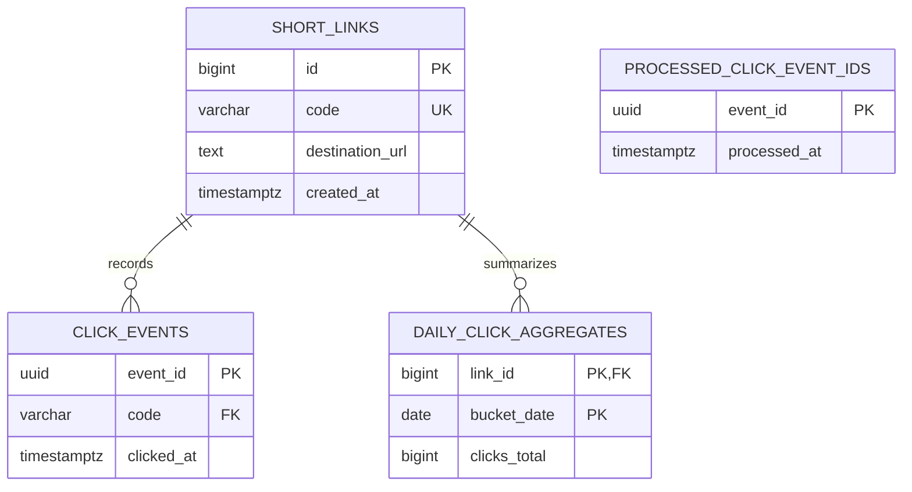

# Engineering Reference: Risks, Assumptions, and Database Design

**Status:** Current baseline reference for the URL-shortener assignment prototype  
**Scope:** Summarizes accepted design assumptions, open decisions and material
risks, plus the PostgreSQL schema implemented by Alembic revisions
`20261010_01`, `20261012_01`, and `20261012_02`.
This is a reviewer-friendly companion to the [engineering design](03-engineering-design.md),
not a separate approval or production-readiness sign-off.

## At a Glance

- PostgreSQL is authoritative for short links, raw click events, daily
  aggregates, and event-ID deduplication markers. Redis is a disposable link
  cache, rate-limit store, and transport for best-effort click events.
- Analytics events contain only event ID, short-link code, and UTC timestamp.
- The baseline accepts absolute HTTP(S) URLs only, does not fetch destinations,
  and does not collect IP addresses or user-agent strings.
- Click analytics are asynchronous and best effort. The most recent local
  benchmark reports show an unresolved persisted-versus-acknowledged count
  discrepancy; see [current evidence](#current-validation-and-open-evidence).
- Local load tests complete the assignment's diagnostic validation but do not
  meet or accept Q-6/Q-7. Formal capacity acceptance requires a production-like
  environment with comparable topology/resources and a separate load generator.

## Assumptions and Decisions

| Topic | Current assumption or decision | Status / consequence |
|---|---|---|
| Technology | Python 3.11+, FastAPI, async SQLAlchemy 2.x, PostgreSQL, and Redis are constraints of the engineering design for this use case. The assignment itself does not mandate this stack. | Implemented for this prototype; not an externally approved project-wide technology policy. |
| Source of truth | PostgreSQL owns the durable short-link mapping, click-event rows, daily aggregates, and event-ID deduplication markers. Redis cache entries can expire or be lost without invalidating stored links. | Implemented. |
| Destination handling | Accept absolute `http` and `https` URLs with a host and valid port. Store and redirect to the supplied destination; never fetch it during creation. | Implemented. This reduces server-side request forgery exposure but does not prevent phishing or abusive destinations. |
| Short codes | Generate random Base62 codes (initial length eight; schema permits up to 16 characters) and retry bounded unique-code conflicts. An accepted brownfield extension permits optional aliases of 3–16 lowercase ASCII letters, digits, or hyphens, with alphanumeric ends and reserved route names. | Implemented; aliases share the same code namespace and unique constraint. |
| Redirect behavior | Known links return `302`; unknown codes return `404` only after PostgreSQL confirms no mapping. A Redis failure falls back to PostgreSQL. | Implemented. |
| Analytics scope | Record only UUID event ID, short-link code, and UTC click time; expose a trailing-12-calendar-month total. No IP, user-agent, or other personal-data collection. | Implemented. Daily aggregate reporting remains outside the response contract. |
| Retention | Delete raw click events after 90 days; delete aggregate buckets and dedupe markers after 12 calendar months. | Implemented as hourly worker cleanup; rows may remain until the next successful cleanup cycle. |
| Analytics access | One shared Bearer API key authenticates analytics access. This assignment prototype has no per-user or per-link authorization model. | Implemented; do not treat the shared key as fine-grained authorization. |
| Abuse limits | Redis-backed per-client fixed-window limits: 10 creations, 120 redirects, and 60 analytics requests per 60 seconds. Forwarded client IPs are trusted only from configured proxy CIDRs. | Implemented; these quotas do not replace abuse review, link ownership, or administrative controls. |
| Click delivery | Redirect responses do not wait for click persistence. Background publication to Redis Streams is best effort; worker inserts the event, daily aggregate, and dedupe marker transactionally, then acknowledges it. | Accepted prototype trade-off. A process failure before publication or Redis data loss can lose analytics. |
| Performance targets | Q-6 is approximately 1,000 redirects/s and 10 creations/s at 100:1. Q-7 is redirect P95 <= 50 ms and creation P95 <= 200 ms at that workload. | Required targets, not achieved results. Current local measurements fail these targets. |
| Test environment | Local PostgreSQL and Redis support development, integration testing, and harness diagnostics. | Does not represent production capacity. Formal performance acceptance needs representative deployed resources and a separate load generator. |
| Product/security scope | The ambiguous scope explicitly accepts a shared analytics key and limits. Destination abuse reporting, link ownership/admin controls, expiration, and deletion/update semantics are not included. | Implemented controls do not make the service approved for public deployment; resolve remaining controls before exposure. |
| Approval | Baseline acceptance is simulated by the candidate acting as business/engineering owner. | No external stakeholder approval or production operating commitment is implied. |

## Database Design

### Entity relationship



### `short_links`

| Column | PostgreSQL type | Null/default | Constraint and purpose |
|---|---|---|---|
| `id` | `BIGINT` identity | Not null | Primary key; internal stable reference from click events. |
| `code` | `VARCHAR(16)` | Not null | Unique constraint `uq_short_links_code`; public short code and redirect lookup key. |
| `destination_url` | `TEXT` | Not null | Validated absolute HTTP(S) destination; the service does not dereference it. |
| `created_at` | `TIMESTAMPTZ` | Not null, `now()` | Creation time with timezone. |

**Indexes:** Primary key on `id`. The unique constraint on `code` supplies a
unique B-tree index used for direct lookup and collision enforcement for both
generated codes and user-selected aliases.

### `click_events`

| Column | PostgreSQL type | Null/default | Constraint and purpose |
|---|---|---|---|
| `event_id` | `UUID` | Not null | Primary key and idempotency key for worker retries. |
| `code` | `VARCHAR(16)` | Not null | Foreign key to the unique `short_links.code`. |
| `clicked_at` | `TIMESTAMPTZ` | Not null | Click event time in UTC. |

**Indexes:** Primary key on `event_id`. Composite descending index
`ix_click_events_code_clicked_at` on `(code, clicked_at DESC)` supports
per-link raw-event queries.

`daily_click_aggregates` stores `(link_id, bucket_date, clicks_total)` with
`(link_id, bucket_date)` as its primary key. `processed_click_event_ids` stores
only `(event_id, processed_at)` for deduplication after raw-event deletion.
Neither table adds IP, user-agent, or other personal-data fields.

### Persistence and event lifecycle

1. Creation validates input, inserts the link, and commits to PostgreSQL.
   Redis cache population occurs after commit and is best effort; a cache-write
   failure does not undo a persisted link.
2. Redirect resolution reads Redis first, then PostgreSQL on a cache miss or
   cache failure. A successful lookup may populate Redis with a finite TTL.
3. The redirect schedules an event containing `event_id`, `code`, and
   `clicked_at` for Redis Stream publication after the response.
4. The worker resolves the code to the internal link ID, records a dedupe
   marker, stores raw events younger than 90 days, and increments the UTC
   day's aggregate for events inside the 12-month horizon in one transaction.
5. Analytics sums daily aggregate buckets; it can lag recent redirects while
   events are waiting to publish or process.

### Migration and inspection

Apply all current schema revisions:

```powershell
alembic upgrade head
```

Inspect the migrated tables in PostgreSQL:

```powershell
docker exec url-shortener-postgres psql -U postgres -d url_shortener -c "\d+ short_links"
docker exec url-shortener-postgres psql -U postgres -d url_shortener -c "\d+ click_events"
docker exec url-shortener-postgres psql -U postgres -d url_shortener -c "\d+ daily_click_aggregates"
```

Revision `20261012_01` seeds each existing `clicks_total` value into a daily
baseline bucket dated on migration day. Historical dates cannot be recovered
from that lifetime counter; the baseline remains in the API total for up to
12 months after migration. Revision `20261012_02` converts existing event
references from internal IDs to public codes. Use `alembic downgrade base`
only for a disposable development or test database because it removes schema
and data.

## Risks and Mitigations

| Risk | Evidence / impact | Current mitigation | Status / follow-up |
|---|---|---|---|
| Capacity targets are not met by local measurements. | Latest local runs achieved about 34.5 redirects/s and 9.9 creations/s, about a 3.5:1 ratio, and client-observed P95 of 5.8–7.8 seconds for redirects and 5.7–7.4 seconds for creations; these miss the 1,000 redirects/s, 100:1, 50 ms, and 200 ms targets. Local service co-location is not representative. | Reproducible warm/cold benchmark reports client-observed latency, actual throughput, cache, dependency, pool, and worker metrics. Local diagnostics complete the assignment evidence package, with limits disclosed. | **Open for capacity acceptance, not assignment hand-in:** Do not claim Q-6/Q-7. Reconcile persisted-versus-acknowledged event counts, then rerun on a production-like topology/resource configuration using a separate load generator. |
| Click analytics may be lost or delayed. | Publication happens after the redirect response; process failure before publication or Redis Stream loss can lose clicks. Worker backlog delays the analytics total. | Idempotent worker transaction, pending recovery, lag/pending metrics, and documented best-effort guarantee. | **Accepted prototype limitation:** The user accepted best-effort delivery for this assignment; adopt an outbox/synchronous publication only if a future requirement changes. |
| Recent local benchmark analytics counts disagree. | Warm report: 2,797 expected/persisted vs 1,390 acknowledged. Cold report: 2,720 expected/persisted vs 1,359 acknowledged. Reports showed zero lag/pending but timed out draining. | Exact-marker cleanup was run successfully for both reports; reports and values are retained. | **Open investigation:** Reconcile persisted-event and acknowledged-event telemetry before another benchmark. Do not infer cause from these measurements alone. |
| Public API can be abused or used for harmful redirects. | Shared analytics authentication and per-client rate limits are implemented, but a legitimate redirect service may still be abused for phishing or automated traffic. | URL scheme/host validation, no destination dereference, HMACed short-lived client rate buckets, and bounded logs/metrics. | **Open before public exposure:** Add destination-abuse controls and ownership/administrative flows. HTTP(S) validation and rate limits alone are not abuse prevention. |
| Operational metrics could disclose service data or be scraped by untrusted clients. | Metrics expose operational health and are served by separate processes/listeners. | Private listeners default to loopback; public `/metrics` route returns 404; deployment guidance says not to proxy metrics through the public gateway. | **Deployment check:** Preserve loopback/private binding and enforce network ACLs/firewall allowlists if remote scraping is configured. |
| Database or Redis unavailability affects service behavior. | PostgreSQL is required for new creation and uncached lookups; Redis is required for the normal cache/stream path. | PostgreSQL failures return service errors, cache failures fall back to PostgreSQL, readiness reports dependency health, and worker retries startup/recovery paths. | **Operational follow-up:** Define production SLOs, backups/restore, failover, and alert response; these are not established by local tests. |
| Click-event storage and Redis Stream growth need lifecycle policy. | Raw event rows, aggregate buckets, and dedupe markers have configured retention; safe stream trimming can intentionally stop before pending entries and exceed the configured maximum. | Hourly database cleanup applies 90-day raw and 12-month aggregate/dedupe retention; periodic safe stream trimming preserves pending/unprocessed entries. | **Operational follow-up:** Verify cleanup/Redis persistence and define backup deletion behavior before production or high-volume operation. |
| Destination URLs can contain sensitive query values and can lead users to malicious sites. | Full destination URLs are stored to perform redirects. HTTP(S)-only validation does not assess destination reputation or user safety. | Request/service logging uses allowlisted fields and avoids logging complete destination URLs; creation does not fetch destinations. | **Residual risk:** Define abuse reporting, warnings/blocklists, and handling of sensitive URLs if required. |
| Connection pools can exhaust shared service limits as processes scale. | DB and Redis pools are process-scoped; increasing API or worker process count multiplies total connections. | Pool sizes, overflow, timeouts, and Redis connection limits are configurable; pool utilization is instrumented. | **Before scaling:** Budget aggregate connections against PostgreSQL/Redis limits and tune using representative telemetry. |
| Prototype documentation and tests do not establish production readiness. | Assignment-level setup/sign-off was completed in a newly created Python environment. A separate clean-environment sign-off using a fresh checkout and empty-database migration has not been completed; external stakeholder approval, production deployment strategy, and backup/restore evidence are also not recorded. | Setup, API behavior, tests, failure semantics, metrics controls, and known limitations are documented. | **Open before production:** Complete fresh-checkout/empty-database validation and production design/deployment and backup/restore reviews; do not conflate these with the completed assignment-level sign-off. |

## Current Validation and Open Evidence

- Current regular-suite result after the accepted tracking controls:
  with `URL_SHORTENER_RUN_INTEGRATION=1`: `python -m pytest -q` — **128 passed,
  no skips** after the worker invalid-event and reserved-route review fixes.
  The integration test file alone passed **2 tests** against configured
  PostgreSQL and Redis. Without the opt-in, the prior regular-suite result was
  123 passed and 2 integration tests skipped.
- Revisions `20261012_01` and `20261012_02` were applied to PostgreSQL and the
  schema was inspected at `20261012_02`. Integration tests and a manual
  create/redirect/analytics check confirm event publication, persistence, and
  worker aggregation.
- The user reported rotating the analytics key after an earlier shared-terminal
  exposure. After a later IDE exposure, no subsequent rotation is confirmed;
  security remediation remains open until that rotation is confirmed. The key
  value is not recorded.
- Dependency check: `python -m pip check` — no broken requirements.
- Local warm/cold benchmark reports are stored in
  [`t110-local-load-test.json`](t110-local-load-test.json),
  [`t110-cold-load-test.json`](t110-cold-load-test.json),
  [`t110-warm-results.json`](t110-warm-results.json), and
  [`t110-cold-results.json`](t110-cold-results.json). The latest human-run
  pair's cleanup completed, but its persisted-versus-acknowledged discrepancy
  remains open.
- Q-6/Q-7 are **not accepted**. Local diagnostic validation is complete for
  assignment delivery with this limitation disclosed; it does not replace a
  production-like capacity run with comparable topology/resources and a
  separate load generator.
- T-111 assignment-level setup/sign-off is complete in a newly created Python
  environment. The validation used the existing checkout/database, so the
  separate clean-environment sign-off for a fresh checkout and empty-database
  migration remains outstanding. External approval and production readiness
  are not claimed.

See the [README](../README.md) for setup, API use, tests, and benchmark commands,
the [engineering breakdown](04-engineering-breakdown.md) for task history and
human validation records, and the [AI-assisted work log](ai-usage-log.md) for
per-task review and evidence.
