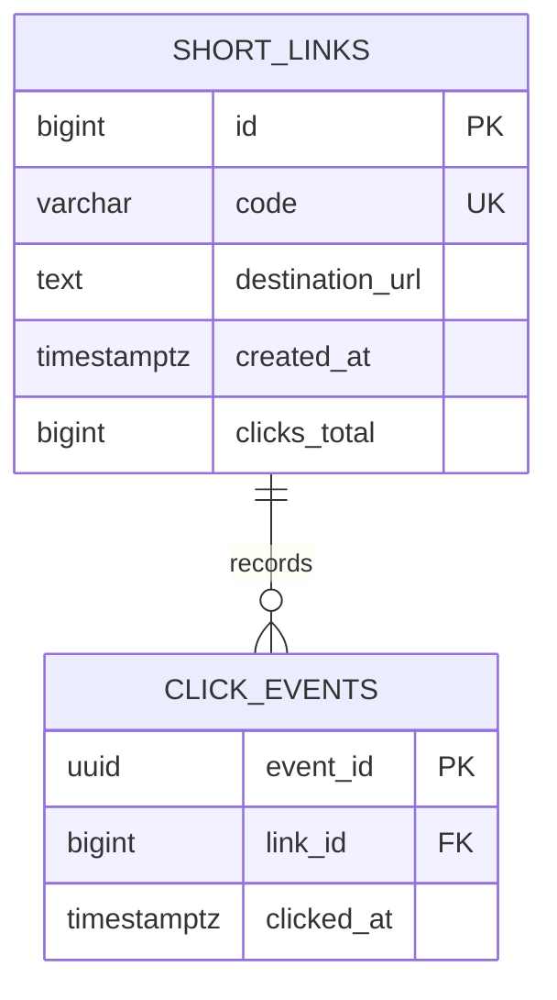

# Engineering Reference: Risks, Assumptions, and Database Design

**Status:** Current baseline reference for the URL-shortener assignment prototype  
**Scope:** Summarizes accepted design assumptions, open decisions and material
risks, plus the PostgreSQL schema implemented by Alembic revision `20261010_01`.
This is a reviewer-friendly companion to the [engineering design](03-engineering-design.md),
not a separate approval or production-readiness sign-off.

## At a Glance

- PostgreSQL is authoritative for short links, click events, and aggregate
  click counts. Redis is a disposable link cache and the transport for
  best-effort click events.
- The database has two tables: `short_links` and `click_events`.
- The baseline accepts absolute HTTP(S) URLs only, does not fetch destinations,
  and does not collect IP addresses or user-agent strings.
- Click analytics are asynchronous and best effort. The most recent local
  benchmark reports show an unresolved persisted-versus-acknowledged count
  discrepancy; see [current evidence](#current-validation-and-open-evidence).
- Local load tests are diagnostic. Q-6/Q-7 remain unaccepted; their formal
  acceptance requires a representative deployment and a separate load
  generator.

## Assumptions and Decisions

| Topic | Current assumption or decision | Status / consequence |
|---|---|---|
| Technology | Python 3.11+, FastAPI, async SQLAlchemy 2.x, PostgreSQL, and Redis are constraints of the engineering design for this use case. The assignment itself does not mandate this stack. | Implemented for this prototype; not an externally approved project-wide technology policy. |
| Source of truth | PostgreSQL owns the durable short-link mapping, click-event rows, and `clicks_total` aggregate. Redis cache entries can expire or be lost without invalidating stored links. | Implemented. |
| Destination handling | Accept absolute `http` and `https` URLs with a host and valid port. Store and redirect to the supplied destination; never fetch it during creation. | Implemented. This reduces server-side request forgery exposure but does not prevent phishing or abusive destinations. |
| Short codes | Generate random Base62 codes (initial length eight; schema permits up to 16 characters) and retry bounded unique-code conflicts. An accepted brownfield extension permits optional aliases of 3–16 lowercase ASCII letters, digits, or hyphens, with alphanumeric ends and reserved route names. | Implemented; aliases share the same code namespace and unique constraint. |
| Redirect behavior | Known links return `302`; unknown codes return `404` only after PostgreSQL confirms no mapping. A Redis failure falls back to PostgreSQL. | Implemented. |
| Analytics scope | Record a UUID event ID, link ID, and UTC click time; expose the asynchronously maintained total count. No IP or user-agent collection. | Implemented. Time-series reporting, privacy retention policy, and access policy beyond the current API contract remain undecided. |
| Click delivery | Redirect responses do not wait for click persistence. Background publication to Redis Streams is best effort; worker inserts the event and increments the aggregate transactionally and idempotently, then acknowledges it. | Implemented prototype trade-off. A process failure before publication or Redis data loss can lose analytics. Loss-resistant delivery requires an approved change such as a transactional outbox. |
| Performance targets | Q-6 is approximately 1,000 redirects/s and 10 creations/s at 100:1. Q-7 is redirect P95 <= 50 ms and creation P95 <= 200 ms at that workload. | Required targets, not achieved results. Current local measurements fail these targets. |
| Test environment | Local PostgreSQL and Redis support development, integration testing, and harness diagnostics. | Does not represent production capacity. Formal performance acceptance needs representative deployed resources and a separate load generator. |
| Product/security scope | Authentication, rate limiting, abuse reporting, administrative controls, expiration, and deletion/update semantics are not specified in the baseline. Custom aliases were separately approved as a brownfield extension. | Keep remaining features out of scope until explicitly approved. Resolve security controls before public exposure. |
| Approval | Baseline acceptance is simulated by the candidate acting as business/engineering owner. | No external stakeholder approval or production operating commitment is implied. |

## Database Design

### Entity relationship



### `short_links`

| Column | PostgreSQL type | Null/default | Constraint and purpose |
|---|---|---|---|
| `id` | `BIGINT` identity | Not null | Primary key; internal stable reference from click events. |
| `code` | `VARCHAR(16)` | Not null | Unique constraint `uq_short_links_code`; public short code and redirect lookup key. |
| `destination_url` | `TEXT` | Not null | Validated absolute HTTP(S) destination; the service does not dereference it. |
| `created_at` | `TIMESTAMPTZ` | Not null, `now()` | Creation time with timezone. |
| `clicks_total` | `BIGINT` | Not null, `0` | Asynchronously maintained aggregate; check constraint `ck_short_links_clicks_total_nonnegative` prevents negative values. |

**Indexes:** Primary key on `id`. The unique constraint on `code` supplies a
unique B-tree index used for direct lookup and collision enforcement for both
generated codes and user-selected aliases.

### `click_events`

| Column | PostgreSQL type | Null/default | Constraint and purpose |
|---|---|---|---|
| `event_id` | `UUID` | Not null | Primary key and idempotency key for worker retries. |
| `link_id` | `BIGINT` | Not null | Foreign key to `short_links.id`. |
| `clicked_at` | `TIMESTAMPTZ` | Not null | Click event time in UTC. |

**Indexes:** Primary key on `event_id`. Composite descending index
`ix_click_events_link_id_clicked_at` on `(link_id, clicked_at DESC)` supports
per-link time-window queries.

The schema intentionally has no IP address, user-agent, expiration,
deletion, or alias-specific fields; the alias is stored directly in `code`.
It does not define a retention policy for
stored click events; decide retention and deletion behavior before those
requirements are introduced.

### Persistence and event lifecycle

1. Creation validates input, inserts the link, and commits to PostgreSQL.
   Redis cache population occurs after commit and is best effort; a cache-write
   failure does not undo a persisted link.
2. Redirect resolution reads Redis first, then PostgreSQL on a cache miss or
   cache failure. A successful lookup may populate Redis with a finite TTL.
3. The redirect schedules an event containing `event_id`, `link_id`, and
   `clicked_at` for Redis Stream publication after the response.
4. The worker inserts the event and increments `short_links.clicks_total` in
   one PostgreSQL transaction. Event UUID uniqueness prevents duplicate
   increments on redelivery. The worker acknowledges a stream item after the
   transaction commits.
5. Analytics reads `clicks_total`; it can lag recent redirects while events
   are waiting to publish or process.

### Migration and inspection

The schema is created by Alembic revision `20261010_01`:

```powershell
alembic upgrade head
```

Inspect the migrated tables in PostgreSQL:

```powershell
docker exec url-shortener-postgres psql -U postgres -d url_shortener -c "\d+ short_links"
docker exec url-shortener-postgres psql -U postgres -d url_shortener -c "\d+ click_events"
```

The migration downgrade drops the click-event index and table before dropping
`short_links`. Use `alembic downgrade base` only for a disposable development
or test database because it removes the schema and its data.

## Risks and Mitigations

| Risk | Evidence / impact | Current mitigation | Status / follow-up |
|---|---|---|---|
| Capacity targets are not met by local measurements. | Recorded local runs miss Q-6/Q-7 by a wide margin; local co-location prevents a representative capacity conclusion. | Reproducible warm/cold benchmark reports client-observed latency, actual throughput, cache, dependency, pool, and worker metrics. | **Open:** Do not claim target capacity. Formal validation awaits representative resources and a separate load generator. |
| Click analytics may be lost or delayed. | Publication happens after the redirect response; process failure before publication or Redis Stream loss can lose clicks. Worker backlog delays `clicks_total`. | Idempotent worker transaction, pending recovery, lag/pending metrics, and documented best-effort guarantee. | **Accepted prototype limitation:** Decide acceptable loss and Redis durability; adopt an outbox/synchronous publication only if approved. |
| Recent local benchmark analytics counts disagree. | Warm report: 2,797 expected/persisted vs 1,390 acknowledged. Cold report: 2,720 expected/persisted vs 1,359 acknowledged. Reports showed zero lag/pending but timed out draining. | Exact-marker cleanup was run successfully for both reports; reports and values are retained. | **Open investigation:** Reconcile persisted-event and acknowledged-event telemetry before another benchmark. Do not infer cause from these measurements alone. |
| Public API can be abused or used for harmful redirects. | Baseline has no authentication or rate limiting, and a legitimate redirect service may be abused for phishing or automated traffic. | URL scheme/host validation and no destination dereference; metrics and logs are bounded and avoid URLs/codes. | **Open before public exposure:** Decide and implement gateway/application rate limits, abuse controls, and ownership/administrative flows. HTTP(S) validation alone is not an abuse-prevention control. |
| Operational metrics could disclose service data or be scraped by untrusted clients. | Metrics expose operational health and are served by separate processes/listeners. | Private listeners default to loopback; public `/metrics` route returns 404; deployment guidance says not to proxy metrics through the public gateway. | **Deployment check:** Preserve loopback/private binding and enforce network ACLs/firewall allowlists if remote scraping is configured. |
| Database or Redis unavailability affects service behavior. | PostgreSQL is required for new creation and uncached lookups; Redis is required for the normal cache/stream path. | PostgreSQL failures return service errors, cache failures fall back to PostgreSQL, readiness reports dependency health, and worker retries startup/recovery paths. | **Operational follow-up:** Define production SLOs, backups/restore, failover, and alert response; these are not established by local tests. |
| Click-event storage and Redis Stream growth need lifecycle policy. | Click events have no time-based retention/deletion policy. Safe stream trimming can intentionally stop before pending entries and exceed the configured approximate length. | Periodic safe trimming preserves pending/unprocessed entries; the database index supports time-based queries. | **Open product/operations decision:** Set retention, archival, deletion, and Redis persistence policies before production or high-volume operation. |
| Destination URLs can contain sensitive query values and can lead users to malicious sites. | Full destination URLs are stored to perform redirects. HTTP(S)-only validation does not assess destination reputation or user safety. | Request/service logging uses allowlisted fields and avoids logging complete destination URLs; creation does not fetch destinations. | **Residual risk:** Define abuse reporting, warnings/blocklists, and handling of sensitive URLs if required. |
| Connection pools can exhaust shared service limits as processes scale. | DB and Redis pools are process-scoped; increasing API or worker process count multiplies total connections. | Pool sizes, overflow, timeouts, and Redis connection limits are configurable; pool utilization is instrumented. | **Before scaling:** Budget aggregate connections against PostgreSQL/Redis limits and tune using representative telemetry. |
| Prototype documentation and tests do not establish production readiness. | No clean-environment sign-off, external stakeholder approval, deployment strategy, or backup/restore evidence is recorded. | Setup, API behavior, tests, failure semantics, metrics controls, and known limitations are documented. | **Open:** Complete clean setup/sign-off and production design review before deployment. |

## Current Validation and Open Evidence

- Current regular-suite result: `python -m pytest -q` — **102 passed, 2 skipped**
  (both PostgreSQL/Redis integration tests are opt-in).
- Integration-enabled result: `tests\test_service_integration.py` — **2 passed**
  against configured PostgreSQL and Redis, including the custom-alias flow.
- Dependency check: `python -m pip check` — no broken requirements.
- Local warm/cold benchmark reports are stored in
  [`t110-local-load-test.json`](t110-local-load-test.json),
  [`t110-cold-load-test.json`](t110-cold-load-test.json),
  [`t110-warm-results.json`](t110-warm-results.json), and
  [`t110-cold-results.json`](t110-cold-results.json). The latest human-run
  pair's cleanup completed, but its persisted-versus-acknowledged discrepancy
  remains open.
- Q-6/Q-7 are **not accepted**. The local results are diagnostic and do not
  replace a representative capacity run.
- T-111 documentation is assembled. Clean-environment human sign-off remains
  pending; no external approval or production readiness is claimed.

See the [README](../README.md) for setup, API use, tests, and benchmark commands,
the [engineering breakdown](04-engineering-breakdown.md) for task history and
human validation records, and the [AI-assisted work log](ai-usage-log.md) for
per-task review and evidence.
