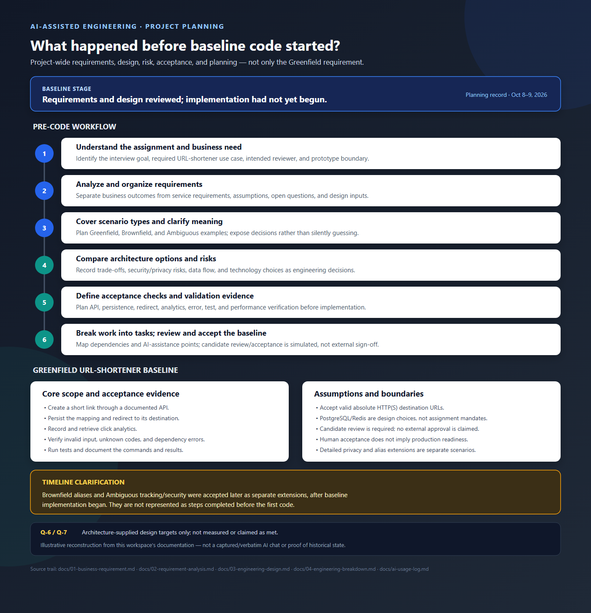

# Greenfield Requirements: URL-Shortener Baseline

**Status:** Baseline accepted for assignment planning; performance targets
remain unaccepted pending representative measurement.  
**Scope:** Core URL-shortener use case and its verification requirements.

## Purpose and scope

Implement a service that creates short links, persists their mappings,
redirects visitors, and records/retrieves click analytics for this
PostgreSQL/Redis engineering prototype. The
[business requirement](01-business-requirement.md) describes the overall
AI-assisted engineering assignment; the
[requirement analysis](02-requirement-analysis.md) provides the cross-scenario
traceability.

## Functional requirements

| ID | Requirement |
|---|---|
| REQ-4 | `POST /api/v1/shorten` accepts an absolute HTTP(S) destination URL with a valid host and port and returns `201` with `code`, `short_url`, and `created_at`. The service does not fetch the destination. |
| REQ-5 | Persist the short-link mapping so it remains resolvable independently of the cache. |
| REQ-6 | `GET /{code}` returns `302` with a `Location` header containing the stored destination for a known code. Return `404` only after PostgreSQL confirms the code is unknown; return `503` if lookup cannot be completed. |
| REQ-7 | A successful redirect schedules a click event for asynchronous processing. The worker persists events idempotently; `GET /api/v1/links/{code}/analytics` returns `code` and `clicks_total`. Counts may lag, and baseline delivery is best effort. Access and retention constraints are in the [ambiguous requirements](Ambiguous_requirement.MD). |
| REQ-8 | Invalid creation input returns `422`; unknown redirect or analytics codes return `404`; dependency failures that prevent creation or lookup return `503`. Errors use `{"error":{"code":"...","message":"...","details":...}}`. |

## Quality and acceptance requirements

- Automated tests cover creation, persistence, redirect, analytics, invalid
  input, unknown codes, and relevant dependency failures.
- Setup, API contracts, architecture, trade-offs, testing, risks, assumptions,
  and limitations are documented.
- The candidate reviews and validates AI-assisted output; AI does not
  autonomously approve requirements or implementation.
- Greenfield, brownfield, and ambiguous examples each include input, AI
  assistance, human review, and validation evidence.

The architecture-specific workload and latency targets are:

| ID | Target |
|---|---|
| Q-6 | Approximately 1,000 redirect requests/second and 10 link-creation requests/second (100:1 ratio). |
| Q-7 | At that workload, redirect P95 <= 50 ms and `POST /api/v1/shorten` P95 <= 200 ms. |

Q-6/Q-7 are design targets, not business-approved production commitments.
They are unverified validation targets, not achieved results. Local
measurements do not meet them; do not claim acceptance until representative
performance evidence is available. See the
[engineering breakdown](04-engineering-breakdown.md) and
[risk/validation reference](05-risk-assumptions-database-design.md).

## Scope boundaries

The assignment does not prescribe a technology stack or claim production
readiness. The PostgreSQL/Redis design and its detailed endpoint contracts are
engineering decisions documented in the
[engineering design](03-engineering-design.md). Optional custom aliases are
specified separately in the [brownfield requirements](Brownfield_requirement.MD).
Analytics privacy, retention, access, and rate limits are specified separately
in the [ambiguous requirements](Ambiguous_requirement.MD).

## Scenario evidence

- Greenfield: [AI analysis](../evidence/greenfield/ai-analysis.md),
  [human review](../evidence/greenfield/human-review.md), and
  [validation](../evidence/greenfield/validation.md).
- Brownfield: [custom-alias requirements](Brownfield_requirement.MD) and
  [scenario evidence](../evidence/brownfield/ai-analysis.md).
- Ambiguous: [tracking requirements](Ambiguous_requirement.MD) and
  [scenario evidence](../evidence/ambiguous/ai-analysis.md).

## Project-wide pre-implementation workflow illustration

The single image below combines the recorded project-planning steps before
baseline implementation with the Greenfield URL-shortener scope, assumptions,
and acceptance evidence.

The Brownfield alias and Ambiguous tracking/security extensions were accepted
later, after baseline implementation had begun. The illustration calls out
that timeline distinction. It is an illustrative reconstruction from the
workspace documentation, not a captured or verbatim AI conversation and not
proof of historical state.

## Greenfield acceptance checks

- **Creation:** A valid absolute HTTP(S) URL with a host and valid port returns
  `201`; the response includes `code`, `short_url`, and `created_at`. Invalid
  URL input returns `422`.
- **Persistence:** After successful creation, the link remains resolvable from
  PostgreSQL when the cache is empty or unavailable and after an API restart.
- **Redirect:** A known code returns `302` with a `Location` header equal to
  the stored destination. An unknown code returns `404` only after a successful
  PostgreSQL lookup; a lookup outage returns `503`, not a false `404`.
- **Analytics:** A successful redirect is eventually reflected in the
  authenticated analytics response as `code` and `clicks_total`; asynchronous
  freshness and best-effort delivery limits are disclosed.
- **Errors and dependencies:** Confirm the documented `422`, `404`, and `503`
  behaviors and JSON error envelope through automated tests.
- **Q-6/Q-7 measurement:** Report offered and achieved redirect/create rates,
  the 100:1 ratio, client-observed P95 for each endpoint, error rate, duration,
  warm-up, cache state, environment, and load-generator setup. Targets pass
  only if the stated throughput and latency thresholds are met in a
  representative environment. Current local results do not pass.
- **Evidence:** Record test commands and results, benchmark reports, and
  human review decisions. Do not treat a proposed check or AI-generated draft
  as completed validation.
